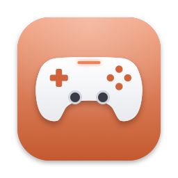
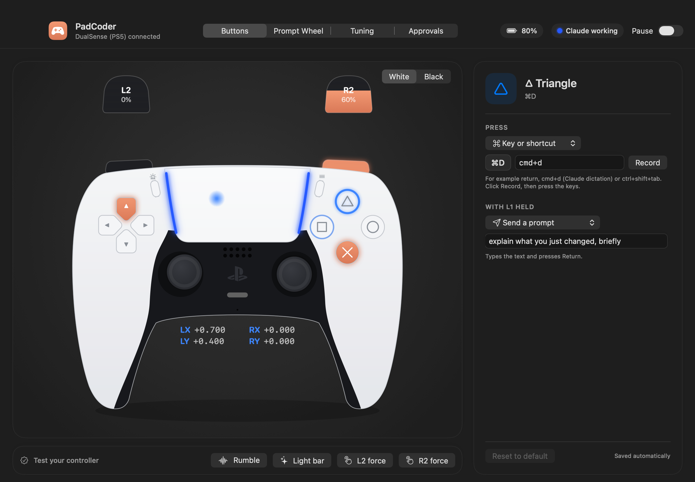

# PadCoder 🎮

Vibe code with a game controller. PadCoder turns a PS5 DualSense or PS4 DualShock 4
(Xbox pads work too) into a keyboard and mouse built for driving
[Claude Code](https://claude.com/claude-code) in the Claude desktop app, or any other Mac app.

- **Buttons for the common moves:** send, stop, dictate, accept, undo and paste, plus quick prompts and a prompt wheel.
- **Approve from the pad:** answer Claude's permission requests with ✕ / ○ after reading the exact command on screen.
- **Status you can feel:** the light bar shows what Claude is doing, and the pad buzzes when Claude finishes or needs you.
- **A live settings window:** a drawing of your controller that lights up as you press. Click any button to remap it.



## Requirements
- macOS 13 or later
- Xcode or the Xcode Command Line Tools (for `swiftc`)
- A DualSense or DualShock 4 paired over Bluetooth or USB

## Install
```bash
git clone https://github.com/mohammednuruddin/padcoder.git
cd padcoder
./build.sh install
open /Applications/PadCoder.app
```
Then turn on **PadCoder** in System Settings → Privacy & Security → **Accessibility**, so it can type and click.
It adds itself as a login item, shows a 🎮 in the menu bar, and opens its window the first time.

`build.sh` signs the app with your Apple Development certificate if you have one, so the
Accessibility permission survives rebuilds. Otherwise it signs ad hoc, and you'll need to turn
Accessibility off and on again after each rebuild.

## The PadCoder window
Open it from 🎮 → **Open PadCoder…**, or open the app again from Spotlight.
- **Buttons**: a live drawing of your controller. It shows a DualSense for PS5 and a DualShock 4 for PS4, in white or black.
  - Buttons light up as you press them. The sticks, triggers, touchpad and light bar move live.
  - Click any part to change what it does, or use **Record** to capture a shortcut.
  - Test buttons for rumble, the light bar, and L2/R2 trigger force (DualSense only).
- **Prompt Wheel**: the 8 wheel prompts and the 4 quick prompts.
- **Tuning**: what each stick does (move the mouse, scroll, or off), stick, scroll, touchpad and gyro speeds, and the invert switches.
- **Approvals**: approve from the pad on/off, and how long to wait.

While the window is in front, the controller only lights things up there. It won't type or click.

## Default buttons

| Button | Does |
|---|---|
| ✕ Cross | **Return**: send / confirm |
| ○ Circle | **Esc**: stop Claude / cancel |
| □ Square | **Backspace** (hold to repeat) |
| △ Triangle | **Cmd+D**: Claude's dictation |
| Options ≡ | **Cmd+Return**: accept a suggested task / submit a dialog |
| D-pad | Arrow keys (hold to repeat) |
| Left stick | Move the mouse. Each stick can be set to move the mouse, scroll, or off. |
| Right stick | Scroll |
| R1 (hold) | **Gyro aim**: tilt the pad to fine-move the mouse |
| R2 / L2 | Left click (hold to drag) / right click |
| L3 / R3 (press sticks) | Cmd+Z undo / Cmd+V paste |
| Create / Share | **Pause / resume** PadCoder (the light bar dims, so you can game) |
| Touchpad | 1 finger moves the mouse · press = click · 2 fingers scroll · quick 2-finger swipe ← / → = previous / next tab |

### Hold L1 for the second layer
| Combo | Does |
|---|---|
| L1 + ✕ / ○ / □ / △ | Quick prompts, such as "yes, go ahead" and "run it and fix any errors" |
| L1 + Options | Cmd+N |
| L1 + R1 | Shift+Tab |
| L1 + D-pad | Page Up / Page Down / Home / End |
| **L1 + right stick** | **Prompt wheel**: point at one of 8 prompts and release L1 to send. Center the stick first to cancel. |

## Light bar = what Claude is doing
| Color | Meaning |
|---|---|
| Orange | Idle |
| Pulsing blue | Working |
| Green flash + 1 buzz | Finished a reply |
| Pulsing red + 3 buzzes | Needs your approval. R2 also gets a "click" resistance (DualSense only) |
| Dim | PadCoder is paused |

## Connect it to Claude Code
The status light, buzzes and pad approvals come from Claude Code
[hooks](https://code.claude.com/docs/en/hooks). Add this to `~/.claude/settings.json`,
merging it with any `hooks` you already have:

```json
{
  "hooks": {
    "UserPromptSubmit": [
      { "hooks": [{ "type": "command", "command": "notifyutil -p com.padcoder.working 2>/dev/null || true", "async": true }] }
    ],
    "PostToolUse": [
      { "matcher": "*", "hooks": [{ "type": "command", "command": "notifyutil -p com.padcoder.working 2>/dev/null || true", "async": true }] }
    ],
    "Stop": [
      { "hooks": [{ "type": "command", "command": "notifyutil -p com.padcoder.buzz 2>/dev/null || true", "async": true }] }
    ],
    "PermissionRequest": [
      { "matcher": "*", "hooks": [{ "type": "command", "command": "\"$HOME/Library/Application Support/PadCoder/permission-hook.sh\"", "timeout": 90 }] }
    ]
  }
}
```

`./build.sh install` puts `permission-hook.sh` in place.

### Approving from the pad
When Claude asks permission, a panel at the top of the screen shows the tool and the exact
command or file. Press **✕ to approve**, **○ to deny**, or **△ to leave it to Claude's normal dialog**.
In the Claude desktop app, the dialog stays usable at the same time and whichever you answer first wins.
In terminal Claude Code, the prompt can wait up to the approval timeout (20 s by default) while a pad is connected.
△ skips the wait, and you can turn approvals off on the Approvals page.

The hook only waits for the pad while PadCoder is running, a controller is connected and PadCoder isn't paused.
Otherwise it exits at once and Claude shows its normal dialog.

## Config file
Everything the window edits lives in `~/Library/Application Support/PadCoder/config.json`
(🎮 → Edit Config File…). Changes apply on save.

Actions:
- a key combo: `"return"`, `"cmd+d"`, `"cmd+return"`, `"ctrl+shift+tab"`
- `"send:text"` types the text and presses Return; `"type:text"` types it without Return
- `"leftClick"`, `"rightClick"`, `"gyro"`, `"pause"`, `"dictation"` (macOS dictation), `"none"`
- in `l1Layer`, `""` means "same as the normal press"

`leftStick` and `rightStick` set what moving each stick does: `"mouse"`, `"scroll"` or `"off"`.

## Development
- `./build.sh` builds `PadCoder.app` in the repo.
- `./build.sh install` also replaces `/Applications/PadCoder.app` and the hook script, and quits the running copy.
  Run `open /Applications/PadCoder.app` afterwards.
- `PadCoder.app/Contents/MacOS/PadCoder --snapshot <dir>` renders the window and HUDs to PNGs, for checking layout.

| File | What's in it |
|---|---|
| `Sources/PadCoder.swift` | Controller input, actions, light bar, triggers, approvals |
| `Sources/Events.swift` | Posting keyboard and mouse events |
| `Sources/Config.swift` | Defaults and the hot-reloaded config file |
| `Sources/ControllerView.swift` | Vector DualSense / DualShock 4 drawings |
| `Sources/SettingsView.swift` | The PadCoder window |
| `Sources/Overlay.swift` | Prompt wheel and approval HUD |
| `hooks/permission-hook.sh` | The Claude Code `PermissionRequest` hook |

## Troubleshooting
The log is at `~/Library/Logs/PadCoder.log` (🎮 → Open Log). It records button presses,
state changes, wheel picks, approvals and config saves.
- **Nothing types or clicks:** check Accessibility for PadCoder, then quit and reopen it.
- **Gyro or scroll goes the wrong way:** use the Tuning page.

## Notes
The controller drawings are original vector art. PlayStation, DualSense and DualShock are
trademarks of Sony Interactive Entertainment. Claude is a trademark of Anthropic.
This project is not affiliated with either company.

## License
[MIT](LICENSE)
